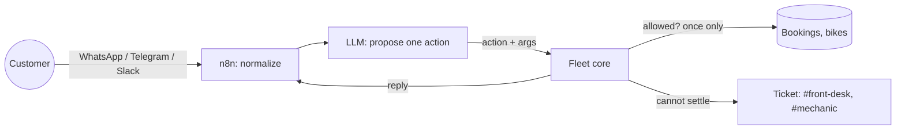
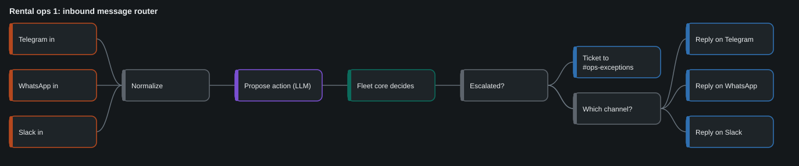

# rental-ops-agents

**Agents answer customers on WhatsApp, Telegram and Slack. A 180-line core makes sure they cannot double-book a bike.**

This is a reference implementation of agent-run operations for a bike rental shop, on a synthetic 60-bike fleet. It is not a client deployment, and every number below comes from a simulation you can re-run. It contains:

- `fleet_core.py`: availability, deposits, hand-overs, returns, extensions and maintenance. Every message is applied at most once.
- `agent.py`: turns a customer message into a proposed action. The offline version is rule-based, so the project runs with no model and no key. In production this is the LLM call.
- three n8n workflows, importable JSON, with a diagram of each;
- `server.py`: a small HTTP face so n8n can call the core;
- `simulate.py`: a season of generated customers with duplicates, unclear messages, missing licenses, late returns and damage;
- 6 invariants, asserted after every message, and 53 tests.

```bash
pip install pytest
python -m pytest -q          # 53 tests
python simulate.py           # 14 days on 60 bikes; writes out/season.md
python server.py             # the core on http://127.0.0.1:8787 for n8n
python tools/build_n8n.py    # regenerate n8n/*.json and docs/*.svg
```

## The rule

The model reads the message and proposes one action. The core decides whether it is allowed, writes it once and words the reply. Anything it cannot settle becomes a ticket for a person, with the reason attached.



Because the model only proposes, swapping it for another model cannot create a double booking. The worst a bad proposal can do is open a ticket.

## The three workflows

| File | Trigger | What it does |
|---|---|---|
| [`n8n/01_inbound_message_router.json`](n8n/01_inbound_message_router.json) | Telegram, WhatsApp, Slack | Normalizes the message, lets the LLM propose an action, posts it to the core, replies on the same channel, and files a ticket if the core escalated |
| [`n8n/02_daily_ops_report.json`](n8n/02_daily_ops_report.json) | 07:00 every day | Asks the core for the day's report, posts a digest to `#ops-daily`, and messages the owner if any bike is overdue |
| [`n8n/03_tickets_to_people.json`](n8n/03_tickets_to_people.json) | every 10 minutes | Reads open tickets, drops the ones already posted, and routes by reason to `#mechanic`, `#front-desk` or `#ops-exceptions` |



The diagrams in `docs/` are drawn from the same node list as the JSON files. They are renderings of the workflow files, not screenshots of an n8n canvas.

**Not yet done:** the workflows have not been imported into a live n8n instance with real Telegram, WhatsApp and Slack credentials. The tests check that each file is wired correctly (every node reachable, every connection valid, every path through the core) and that the HTTP endpoints they call behave as documented.

## Invariants

| ID | Invariant |
|---|---|
| INV-1 | No double booking: two active bookings on one bike never overlap |
| INV-2 | No bike leaves without a paid deposit and a checked license |
| INV-3 | A bike in service is never out with a customer |
| INV-4 | One effect per message: a redelivered message returns the first result and changes nothing |
| INV-5 | Nothing is dropped: every message ends as a result in the log or as a ticket for a person |
| INV-6 | Odometers only go up |

The first simulation run failed INV-3. A customer returned late, and the core handed the same bike to the next customer while it was still out. The fix is one rule: no hand-over while a previous customer has the bike. That case now has its own ticket reason, `previous_customer_not_back`, with alternative bikes attached.

## A simulated season

`python simulate.py` with the default seed, 60 bikes, 14 days:

| | |
|---|---|
| Messages | 706 (WhatsApp 409, Telegram 235, Slack 62) |
| Handled without a person | 657 (93.1%) |
| Sent to a person | 49 |
| Bookings, hand-overs, returns | 195, 114, 84 |

| Why a person was needed | Count |
|---|---|
| The message was unclear | 24 |
| Hand-over blocked (bike in service or wrong day) | 7 |
| The previous customer was not back | 6 |
| Damage on return | 5 |
| An extension ran into the next booking | 4 |
| No valid license | 3 |

These figures describe the generator's mix of customers, not a real shop. What carries over to a real shop is the last line of the run: the invariants were asserted after each of the 706 messages with no violation, and the same holds for the 25 other seeds in the tests.

## Limits

- State lives in memory. A real deployment needs a database and the same idempotency key on its writes.
- The offline proposer understands a small set of English phrasings. It exists so the tests need no model.
- Payments are a boolean. Checking that a deposit really arrived is a separate integration.
- Days are integers and there is one location.

## Related

[voice-agent-acceptance-tests](https://github.com/galpetame/voice-agent-acceptance-tests) applies the same rule to a phone-booking agent, and [agent-claim-gate](https://github.com/galpetame/agent-claim-gate) to the reports agents write.

## License

MIT
